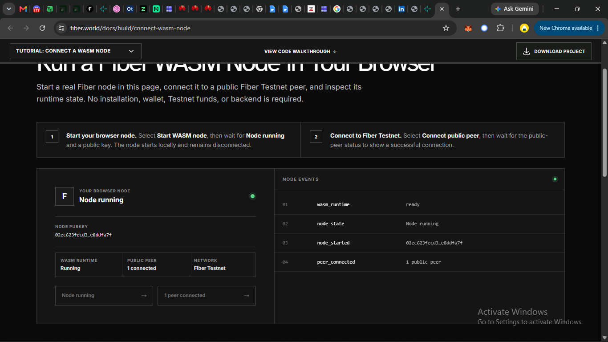
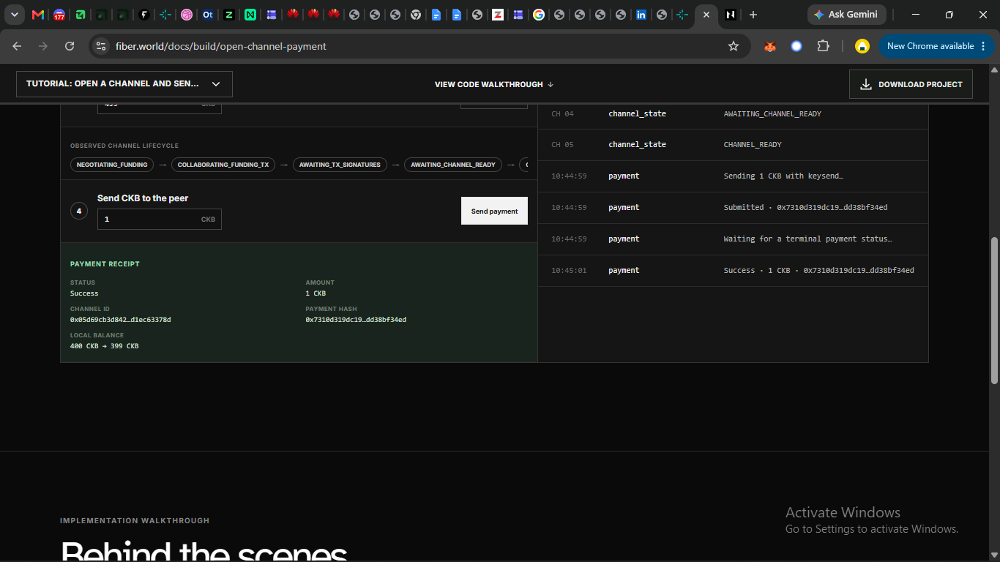
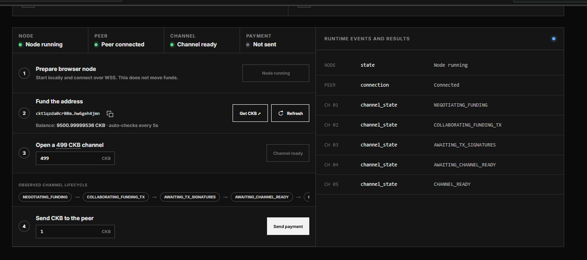

# Fiber: a payment channel opened from a browser tab

My completion of the CKB **Fiber** campaign: a Fiber node compiled to WebAssembly running
inside a browser page, connected to a public Testnet peer over WSS, funding a real
on-chain payment channel, then settling a payment off-chain in two seconds.

Both quests were done in one sitting, same browser profile throughout, on CKB Testnet.

Other campaigns in this repo: [Fiber multi-hop](README.md) · [the xUDT walkthrough](XUDT.md) and the
[xUDT Studio](studio/) dashboard built on top of it.

---

## Quest 1 — A Fiber node running in the page

[Tutorial: Connect a WASM node](https://www.fiber.world/docs/build/connect-wasm-node)



| | |
|---|---|
| Node pubkey | `02ec623fecd3…e8ddfa7f` (the UI ellipsises it) |
| Runtime | Fiber WASM · **Running** |
| Storage | IndexedDB |
| Transport | WSS |
| Network | Fiber Testnet |
| Peers | **1 connected** |

Node events, in order: `wasm_runtime → ready`, `node_state → Node running`,
`node_started → 02ec623fecd3…`, `peer_connected → 1 public peer`.

Two things the sequence makes obvious. The node ran for a while with **zero peers** —
starting a node and joining the network are separate events, and the log shows the gap
between them. And the whole identity lives in **IndexedDB**, which is why the campaign
insists on one browser profile: the key never leaves that origin's storage, so a
different profile is a different node, and clearing site data is key loss.

The page also has to be **cross-origin isolated** (COOP + COEP headers) before it can
start, because the node needs `SharedArrayBuffer` to share memory with its Web Workers.
A browser tab normally cannot have that; the page has to earn it.

## Quest 2 — Open a channel, then pay off-chain

[Tutorial: Open a channel and send a payment](https://www.fiber.world/docs/build/open-channel-payment)



The same identity came back in the same profile — pubkey still `02ec623fecd3…e8ddfa7f` —
and derived its own Testnet address.

| | |
|---|---|
| Funding address | `ckt1qzda0cr08m…hw6geh4jmn` (Testnet) |
| Balance after faucet | 10000 CKB |
| Channel amount | 499 CKB (the public peer's minimum) |
| Balance after opening | 9500.99999536 CKB |
| On-chain fee | **464 shannons** (0.00000464 CKB) |
| Channel ID | `0x05d69cb3d842…d1ec63378d` |
| Payment | 1 CKB, keysend |
| Payment hash | `0x7310d319dc19…dd38bf34ed` |
| Channel local balance | **400 CKB → 399 CKB** |
| Payment status | **Success** |

### The channel lifecycle, as observed

The tutorial names four states. The runtime log shows **five**:

```
NEGOTIATING_FUNDING        agree parameters with the peer
COLLABORATING_FUNDING_TX   build the funding transaction together
AWAITING_TX_SIGNATURES     ← not listed in the tutorial text
AWAITING_CHANNEL_READY     wait for confirmation and both peers
CHANNEL_READY              payments allowed
```



### On-chain versus off-chain, measured

Opening the channel moved real money on Testnet: 499 CKB committed, 464 shannons burned
in fees, and minutes of waiting for confirmation. The payment that followed touched no
block at all:

```
10:44:59  payment  Sending 1 CKB with keysend…
10:44:59  payment  Submitted · 0x7310d319dc19…dd38bf34ed
10:44:59  payment  Waiting for a terminal payment status…
10:45:01  payment  Success · 1 CKB · 0x7310d319dc19…dd38bf34ed
```

**Two seconds, zero fees, no transaction.** That is the entire point of Fiber: pay once
on-chain to open a channel, then settle as often as you like inside it.

### An open question

Committing 499 CKB produced a channel whose spendable local balance was **400 CKB**, not
499. The payment moved it to 399. So roughly **99 CKB is reserved** and cannot be spent
through the channel.

My guess is that it covers the on-chain cell's own capacity — the same rule that makes an
xUDT cell cost 146 CKB — but I have not verified it, and the tutorial does not mention it.
It matters to anyone sizing a channel: the minimum you must commit and the amount you can
actually pay with are different numbers.

---

## Progress shots

| | |
|---|---|
| Funded, channel not yet opened | [`quest2-funded-before-channel.png`](fiber/screenshots/quest2-funded-before-channel.png) |
| Mid-negotiation, `AWAITING_TX_SIGN…` | [`quest2-channel-negotiating.png`](fiber/screenshots/quest2-channel-negotiating.png) |
| `ChannelReady`, before paying | [`quest2-channel-ready.png`](fiber/screenshots/quest2-channel-ready.png) |

---

## Reflection

<!-- Write this yourself, in your own voice. Answer at least three of:
     - something confusing, unexpected or interesting
     - a problem: what you expected, what actually happened, how you resolved it
     - which parts of Fiber interest you most
     - what you would build with a browser-based Fiber node
     - what you would improve about the tutorials

     Your own raw material from this run, all of it specific:
     - the 400 vs 499 balance gap nobody explained
     - AWAITING_TX_SIGNATURES showing up in the log but not in the docs
     - the channel taking minutes, the payment taking 2 seconds
     - needing a page reload before a node could exist at all
     - the identity living in IndexedDB, so the browser profile *is* the wallet

     Delete this comment when you write it. -->

---

## Notes

- Testnet only. Every address here begins with `ckt`.
- All hex strings above are copied as the UI displays them — it truncates each one, so
  none of these are complete values.
- No private keys, seed phrases or browser-storage contents are in this repo or in any
  screenshot.
