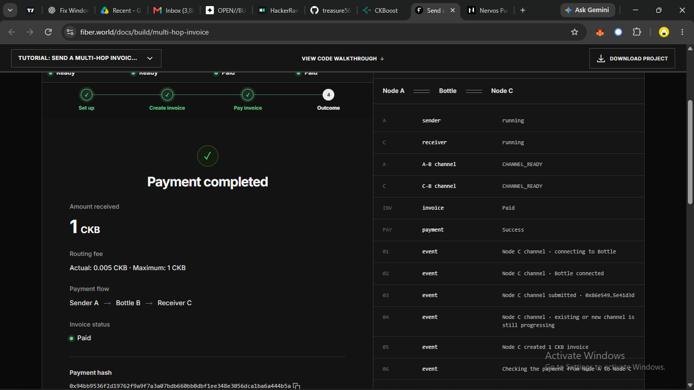
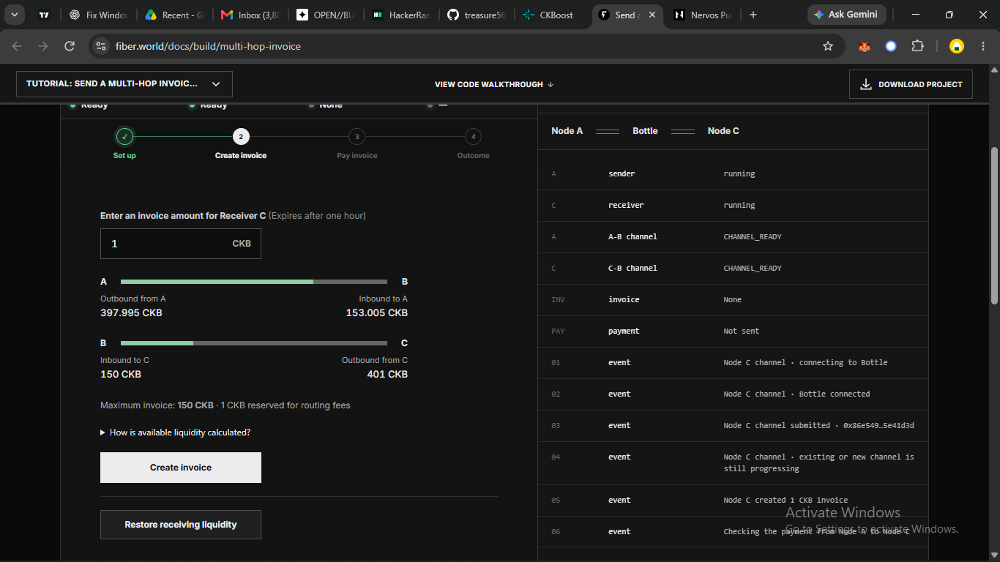
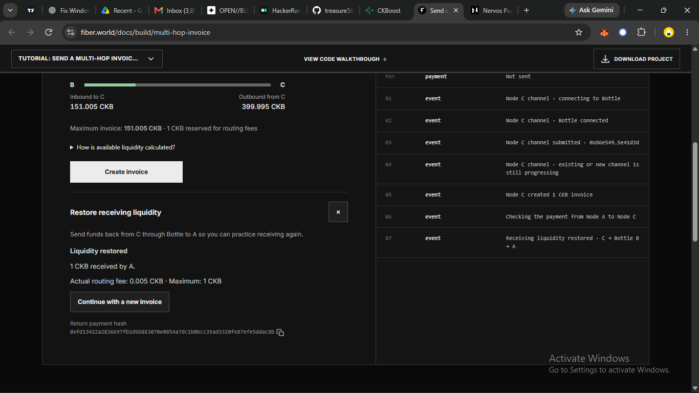
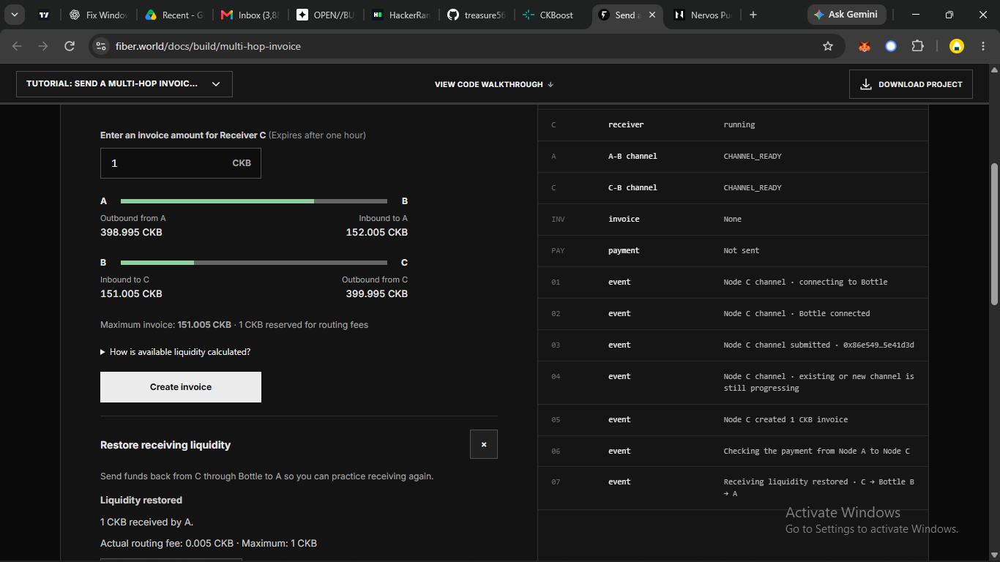

# Paying someone you have no channel with

My completion of the CKB **Fiber multi-hop** campaign: two independent Fiber nodes running
in one browser tab, each with a payment channel to the public intermediary **Bottle**, and a
1 CKB payment routed from one to the other — then reversed, to watch receiving capacity
come back.

The interesting part is not that the payment worked. It is what the four liquidity numbers
do while it works, and what they say about who can pay whom next.

> Tutorial: [Send a Multi-Hop Invoice Payment](https://www.fiber.world/docs/build/multi-hop-invoice) ·
> CKB Testnet · both quests completed in one session, live demo in the browser.

Earlier campaigns in this repo: [Fiber channels](FIBER-CHANNEL.md) · [xUDT](XUDT.md) ·
[xUDT Studio](studio/)

---

## The shape of the problem

A wants to pay C. They share no channel, and opening one costs an on-chain transaction and
locks up capital for a single counterparty. Instead both have a channel with Bottle, and the
payment travels **A → Bottle → C** across two channels that already exist.

For that to work, the money has to already be sitting in the right place:

```
        A ───────── Bottle ───────── C
     outbound     inbound/outbound      outbound
        399          152 │ 151            400        ← CKB, at baseline
                         ^^^
             this number is what lets C be paid
```

A channel's balance has a side. **C's own 400 CKB can only pay outward.** For anyone to pay
C, Bottle must hold funds on *its* side of the B–C channel to push across. That single fact
explains both quests.

## What I did

| # | Step | Evidence |
|---|---|---|
| 1 | Restored Sender A from the previous campaign — its saved channel partner turned out to be Bottle, so A–B was already `CHANNEL_READY` | [cold start](fiber-multihop/screenshots/01-nodes-cold-start.png) |
| 2 | Started Receiver C as a second, independent node with its own identity and storage | [C needs funding](fiber-multihop/screenshots/02-receiver-needs-funding.png) |
| 3 | Funded C's Testnet address from the faucet — 10,000 CKB | [faucet claim](fiber-multihop/screenshots/03-faucet-claim.png) · [funded](fiber-multihop/screenshots/04-receiver-funded.png) |
| 4 | Opened C's 499 CKB public channel to Bottle and watched it negotiate | [collaborating](fiber-multihop/screenshots/05-channel-collaborating-funding-tx.png) · [awaiting ready](fiber-multihop/screenshots/06-channel-awaiting-ready.png) |
| 5 | Both channels `CHANNEL_READY`; recorded the baseline liquidity | [baseline](fiber-multihop/screenshots/07-baseline-liquidity.png) |
| 6 | Created a 1 CKB invoice on C — a `fibt…` Testnet payment request | [invoice open](fiber-multihop/screenshots/08-invoice-created.png) |
| 7 | Paid it from A, with Bottle as the trampoline hop | **Quest 1 proof** below |
| 8 | Sent 1 CKB back, C → Bottle → A, to restore C's receiving capacity | **Quest 2 proofs** below |

On-chain cost of step 4: 10000 → **9500.99999536 CKB**. 499 into the channel, 464 shannons
of fee. Everything after that happened off-chain.

---

## Quest 1 — the forward payment



| | |
|---|---|
| Amount received | 1 CKB |
| Flow | Sender A → Bottle B → Receiver C |
| Invoice status | **Paid** |
| Payment status | **Success** |
| Payment hash | `0x94bb9536f2d19762f9a9f7a3a07bdb660bb0dbf1ee348e3056dca1ba6a444b5a` |
| Routing fee | **actual 0.005 CKB**, against a 1 CKB maximum |

Two details worth pausing on.

**The fee is 200× smaller than the budget.** `max_fee_amount` is a ceiling you authorise,
not a price. Trampoline routing may use all of it, so the gap between 0.005 and 1 is risk
you accept in exchange for the route being found for you.

**The payment hash is not a receipt.** The tutorial says so outright, and the UI backs it:
success is only declared when A reports `Success` *and* C's invoice reads `Paid`, checked
on two different nodes. A hash proves a payment was attempted, not that anybody received it.

## Quest 2 — restoring receiving liquidity

Before the reverse payment — the state left behind by Quest 1:



The restore confirmation, with 1 CKB back at A:



| | |
|---|---|
| Returned | 1 CKB, C → Bottle B → A |
| Return payment hash | `0xfd13422a2836697fb2d5b883070e0854a7dc1b0bcc35ad3320fe87efe5ddac8b` |
| Routing fee | actual 0.005 CKB, maximum 1 CKB |
| Maximum return available | 153.005 CKB |

And after:



---

## The numbers, and what they mean

All figures in CKB, read off the three screenshots above.

| | A outbound | Bottle → A | Bottle → C | C outbound | Max invoice |
|---|---|---|---|---|---|
| **Baseline** | 399 | 152 | 151 | 400 | 151 |
| **After forward** | 397.995 | 153.005 | 150 | 401 | 150 |
| **After reverse** | 398.995 | 152.005 | 151.005 | 399.995 | 151.005 |
| **Net change** | −0.005 | +0.005 | **+0.005** | −0.005 | **+0.005** |

### The forward payment

A paid **1.005** — the invoice amount plus the 0.005 fee — and all of it landed on Bottle's
side of A–B. On the far channel Bottle pushed exactly **1** across to C, so its side fell
151 → 150 while C's rose 400 → 401. Bottle kept the 0.005 difference for forwarding.

The consequence is the one that matters: **C's maximum receivable fell by exactly the amount
it received.** Being paid consumes the counterparty's liquidity. A node that only receives
eventually cannot receive at all, no matter how much money it holds.

### The reverse payment

C sent 1 CKB back and paid its own 0.005 fee, so **1.005** moved from C's side to Bottle's on
the B–C channel: 150 → 151.005. Bottle then forwarded exactly **1** to A across A–B, dropping
its side 153.005 → 152.005.

So C's receiving capacity ended up **higher than it started** — 151.005 against 151 — while C
itself is 0.005 CKB poorer. That asymmetry is the whole lesson in one line: the fee a node
pays to send is paid *into the channel it later wants to receive on*. Sending restores the
ability to be paid, and overshoots slightly, because the fee lands on the useful side.

Bottle finished 0.01 CKB up across the two channels, having never been exposed: it only ever
forwarded money it had already been given.

### Reserves are not fees

Two different numbers get confused here, and the campaign asks about both.

- **The reserve.** I funded 499 CKB and got 400 spendable. The missing ~99 is locked to keep
  the channel's on-chain cell alive; it never moves and cannot be paid. The same ~99 gap
  appeared in the previous campaign. It is a deposit, not a cost.
- **The routing fee.** 0.005 CKB per hop payment, paid to Bottle, actually spent. Tiny in
  absolute terms — but about **1,000× the 464-shannon on-chain fee** I paid to open the
  channel. Off-chain is not free; it is priced for service and liquidity rather than for
  block space.

Neither channel's total changed all day: A–B and B–C each still hold 551 CKB. No new funds
entered. Only the split moved.

### The thing I did not expect

Before starting I assumed a freshly funded channel would be useless for receiving: C puts in
499, so C holds everything and Bottle holds nothing to push across. On that logic Quest 1
could not run at all.

The baseline said otherwise — **151 CKB already sat on Bottle's side of a channel C had just
funded alone.** Bottle contributes its own liquidity when it accepts a public channel. That
is what makes a brand-new node payable on arrival, and it is the quiet thing holding the
whole tutorial up. The docs never mention it.

A–B carried its own evidence: Bottle's side read 152, not 151 — the extra 1 CKB being the
payment I sent it in the previous campaign, still sitting where it landed weeks later.

---

## Reflection

<!-- Mine, in my own words. At least three of:
     - what I learned about the liquidity needed on A–B and B–C
     - why multi-hop payments are useful
     - what was confusing, unexpected or interesting
     - a problem: what I expected, what happened, how I resolved it
     - what I would build with browser nodes, multi-hop payments and invoices
     - how I would improve the tutorial or the reading material

     My own raw material from this run:
     - I expected Bottle's side of C's new channel to be empty; it was 151 CKB
     - the old channel remembering a 1 CKB payment from the previous campaign
     - receiving capacity shrinking every time C got paid
     - the fee being 200x under budget, and 1000x the on-chain fee
     - the reserve showing up again, still unexplained in the docs

     Delete this comment when written. -->

---

## Notes

- Testnet only. Addresses begin with `ckt`; no Mainnet funds were involved.
- Hex strings are reproduced as the UI displays them; where it truncates, so do I.
- No private keys, seed phrases or browser-storage contents are in this repo or in any
  screenshot. Both node identities live in browser IndexedDB and never left it.
